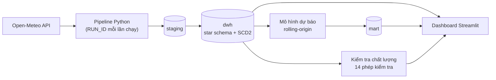

# Nền tảng dữ liệu thời tiết Việt Nam

Pipeline dữ liệu chạy hằng ngày: thu thập dữ liệu thời tiết thật từ Open-Meteo, nạp vào kho dữ liệu **SQL Server**
theo mô hình sao, kiểm tra chất lượng, ước lượng mô hình dự báo nhiệt độ và hiển thị bằng dashboard **Streamlit**.
Xây bằng Python 3.11 và SQL Server 2022.

## Dự án làm gì

Mỗi lần chạy (thường một lần mỗi ngày), hệ thống:

1. Tải quan trắc mới (nhiệt độ, lượng mưa, gió) của 5 thành phố từ Open-Meteo và nạp vào tầng `staging`.
2. Lưu dự báo 7 ngày tới của Open-Meteo để sau này đối chiếu với số đo thực tế.
3. Nạp kho dữ liệu `dwh` (star schema, dimension địa điểm theo SCD Type 2) bằng stored procedure.
4. Chạy 14 phép kiểm tra chất lượng, gồm đối soát staging và fact theo khóa nghiệp vụ.
5. Ước lượng lại mô hình dự báo, kiểm thử ngược (rolling-origin) và ghi kết quả vào `mart`.
6. Ghi lại lần chạy (mã `RUN_ID`, trạng thái, số địa điểm thành công) để truy vết dữ liệu.

Dashboard đọc trực tiếp từ kho dữ liệu, dùng **một bộ lọc chung** (địa điểm, khoảng năm) và ghi rõ mỗi tab áp dụng bộ lọc nào.

## Kiến trúc



Chi tiết từng tầng, luồng chạy, mã thoát và truy vết dữ liệu: [docs/architecture.md](docs/architecture.md).
Sơ đồ mô hình dữ liệu: [docs/data_model.md](docs/data_model.md). Từ điển dữ liệu: [docs/data_dictionary.md](docs/data_dictionary.md).

## Cấu trúc thư mục

```
vn-weather-data-platform/
├── README.md
├── requirements.txt          Thư viện đã ghim phiên bản
├── requirements-dev.txt      Thêm pytest
├── pyproject.toml
├── .env.example              Mẫu cấu hình kết nối (sao chép thành .env)
├── .gitignore
├── src/weather_platform/
│   ├── config.py             Cấu hình và hằng số dùng chung
│   ├── db.py                 Kết nối SQL Server
│   ├── ingestion.py          Gọi API, nạp staging
│   ├── warehouse.py          Gọi stored procedure nạp kho
│   ├── data_quality.py       Kiểm tra chất lượng (Python và gọi SQL)
│   ├── forecast.py           Mô hình, kiểm thử ngược, dự báo
│   ├── analytics.py          Phép tính cho dashboard
│   ├── pipeline.py           Điều phối, nhật ký lần chạy
│   ├── daily_update.py       Điểm vào: chạy hằng ngày
│   └── load_history.py       Điểm vào: nạp lịch sử
├── dashboard/dashboard.py
├── sql/                      Mã SQL (xem sql/README.md)
├── tests/                    Kiểm thử tự động (pytest)
├── docs/                     Kiến trúc, mô hình dữ liệu, từ điển, phương pháp, quyết định thiết kế
└── scripts/                  run_daily.bat, run_dashboard.bat
```

## Cài đặt và chạy

Yêu cầu: Windows, SQL Server 2022 (bản Developer miễn phí), SSMS, ODBC Driver 18 for SQL Server, Python 3.11.
Mặc định kết nối bằng Windows Authentication nên không cần mật khẩu.

**1. Môi trường Python**

```
python -m venv venv
venv\Scripts\activate
pip install -r requirements.txt
pip install -e .
```

**2. Cấu hình kết nối (tùy chọn).** Nếu SQL Server không ở `localhost` hoặc dùng tên database khác, sao chép
`.env.example` thành `.env` và sửa.

**3. Dựng database.** Chạy các file SQL theo thứ tự trong [sql/README.md](sql/README.md).
Nếu đang có database từ bản trước, xem mục "Nâng cấp database đang có" trong file đó.

**4. Nạp dữ liệu và chạy.**

| Việc | Lệnh |
|---|---|
| Nạp lịch sử từ 2020 (một lần) | `python -m weather_platform.load_history` |
| Cập nhật hằng ngày | `python -m weather_platform.daily_update` |
| Mở dashboard | `streamlit run dashboard\dashboard.py` (hoặc `scripts\run_dashboard.bat`) |
| Chạy kiểm thử | `pip install -r requirements-dev.txt` rồi `python -m pytest` |

Mã thoát của pipeline: `0` thành công, `1` một phần (có địa điểm hoặc bước lỗi, hoặc có phép kiểm tra FAIL),
`2` thất bại (kho dữ liệu không được cập nhật).

**5. Lên lịch chạy hằng ngày.** Trong Windows Task Scheduler tạo tác vụ chạy `scripts\run_daily.bat`
(file này tự tính đường dẫn theo vị trí của nó, không phụ thuộc máy). Bật tùy chọn chạy bù khi bỏ lỡ giờ hẹn;
pipeline tự lấy phần dữ liệu còn thiếu nên bỏ lỡ vài ngày không mất dữ liệu.

## Kiểm thử

96 kiểm thử tự động cho phần Python: phân tích phản hồi API, cửa sổ thời gian nạp tăng dần, thử lại khi API lỗi,
cô lập lỗi theo từng địa điểm, các quy tắc kiểm tra dữ liệu, mô hình dự báo (gồm kiểm tra rò rỉ dữ liệu và xử lý
trường hợp suy biến), phương pháp tính ngưỡng cực đoan và logic trạng thái pipeline.
Mã SQL (stored procedure, view) chưa có kiểm thử tự động vì cần SQL Server; xem lưu ý trong [sql/README.md](sql/README.md).

## Kết quả

### Mô hình dự báo nhiệt độ cao nhất

Sai số MAE (độ C), gộp mọi địa điểm, kiểm thử ngược rolling-origin bước 7 ngày trong 2 năm gần nhất
(phương pháp và cách kiểm soát rò rỉ: [docs/forecast_methodology.md](docs/forecast_methodology.md)):

| Dự báo trước | Lặp lại ngày cuối | Đường khí hậu | Khí hậu + hiệu chỉnh AR(1) |
|---|---|---|---|
| 1 ngày | 1,10 | 1,55 | **1,03** |
| 3 ngày | 1,78 | 1,63 | **1,50** |
| 5 ngày | 1,80 | 1,43 | **1,37** |
| 7 ngày | 1,97 | 1,55 | **1,53** |

Các số trên đo từ lần chạy trước khi sửa mã theo góp ý; chạy lại pipeline sẽ cập nhật bảng `mart.forecast_eval`
(đã có thêm RMSE, số quan sát và kết quả riêng từng địa điểm, xem ở tab "Độ chính xác dự báo").
Đây là các mô hình thống kê đơn giản dùng làm mốc so sánh, không thay thế dự báo vật lý.

### Hiệu năng index

Đo trên bảng 4,9 triệu dòng **dữ liệu giả lập**. Với truy vấn tra cứu một trạm, số lần đọc (logical reads) giảm
từ 19.352 xuống 5 khi có nonclustered index. Với truy vấn tổng hợp toàn bảng, columnstore giảm số lần đọc và CPU
nhưng thời gian thực gần như không đổi. Thời gian thực cần được đánh giá trên khối lượng công việc thật và nhiều lần chạy.
Bảng đầy đủ, kể cả các ô chưa đo: [sql/04_benchmark/notes.md](sql/04_benchmark/notes.md).

## Tài liệu

| File | Nội dung |
|---|---|
| [docs/architecture.md](docs/architecture.md) | Luồng dữ liệu, ba tầng, các bước chạy, truy vết dữ liệu, xử lý lỗi từng phần |
| [docs/data_model.md](docs/data_model.md) | Sơ đồ star schema và các bảng khác |
| [docs/data_dictionary.md](docs/data_dictionary.md) | Ý nghĩa, kiểu và nguồn của từng cột |
| [docs/forecast_methodology.md](docs/forecast_methodology.md) | Ba phương pháp, rolling-origin, kiểm soát rò rỉ, chỉ số |
| [docs/decisions.md](docs/decisions.md) | Các quyết định thiết kế và đánh đổi |
| [docs/review_response.md](docs/review_response.md) | Đối chiếu từng góp ý với việc đã làm |

Ảnh chụp dashboard: thêm vào `docs/screenshots/` sau khi chạy dashboard bằng dữ liệu của bạn.

## Hạn chế

- Số liệu là dữ liệu **tái phân tích** (kết hợp quan trắc và mô hình số, độ phân giải khoảng vài chục km), không phải số
  đo từ một trạm cụ thể, và về chậm khoảng 7 ngày (hiển thị thành "Độ trễ dữ liệu" trên dashboard).
- Mô hình dự báo là thống kê đơn giản, đánh giá trên 5 địa điểm. Việc so sánh với dự báo Open-Meteo cần thêm vài tuần
  dữ liệu tích lũy.
- Ngưỡng "ngày có lượng mưa ≥ 50 mm" là ngưỡng phân tích của đề tài, không phải phân loại chính thức của cơ quan khí tượng.
- Bảng hiệu năng dùng dữ liệu giả lập; các ô của truy vấn C, D và cấu trúc clustered chưa đo.
- Hệ thống chạy trên một máy Windows; dashboard chưa được đưa lên mạng công khai.
- `dim_date` đến hết 2035; bảng fact chưa lưu `run_id` (truy vết đi qua staging).

## Nguồn dữ liệu

Weather data by [Open-Meteo.com](https://open-meteo.com/), giấy phép
[CC BY 4.0](https://creativecommons.org/licenses/by/4.0/). API miễn phí cho mục đích phi thương mại.
Dự án dùng cho học tập và trình diễn, chỉ gọi API với tần suất thấp (vài chục yêu cầu mỗi ngày).
