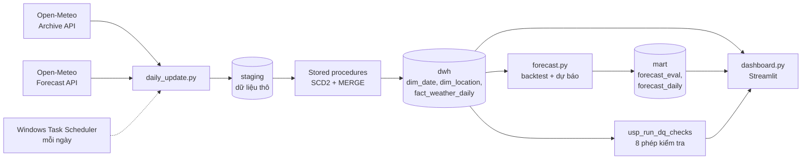

# Nền tảng dữ liệu thời tiết Việt Nam

Pipeline dữ liệu chạy hằng ngày, từ thu thập dữ liệu thời tiết thật đến kho dữ liệu SQL Server,
mô hình dự báo và dashboard. Dự án xây bằng **Python** và **SQL Server 2022**.


## Dự án làm gì

Mỗi ngày, hệ thống tự động:

1. Lấy số liệu thời tiết mới (nhiệt độ, lượng mưa, gió) của 5 thành phố từ Open-Meteo.
2. Lưu dự báo 7 ngày tới của Open-Meteo để sau này đối chiếu với số đo thực tế.
3. Nạp dữ liệu vào kho dữ liệu SQL Server theo mô hình sao (star schema).
4. Chạy 8 phép kiểm tra chất lượng dữ liệu.
5. Huấn luyện lại mô hình dự báo nhiệt độ và ghi kết quả về SQL Server.
6. Dashboard Streamlit đọc trực tiếp từ kho dữ liệu để hiển thị.

Dữ liệu hiện có: 5 địa điểm (Hà Nội, Đà Nẵng, TP.HCM, Cần Thơ, Vũng Tàu),
từ 01/01/2020, khoảng 12.000 dòng ở bảng fact.

## Kiến trúc



## Điểm kỹ thuật chính

- **Kho dữ liệu 3 tầng** `staging`, `dwh`, `mart`. Bảng fact có grain là một địa điểm trong một ngày.
- **Nạp tăng dần bằng `MERGE`** trong stored procedure, so sánh giá trị bằng `EXCEPT` để xử lý đúng `NULL`.
  Chạy lại nhiều lần không sinh dòng trùng.
- **SCD Type 2** cho dimension địa điểm: khi thuộc tính (tọa độ, vùng) thay đổi, hệ thống đóng
  phiên bản cũ và mở phiên bản mới, các dòng fact cũ vẫn trỏ về đúng phiên bản.
- **Kiểm tra chất lượng dữ liệu**: trùng khóa, dòng không khớp dimension, chênh lệch số dòng,
  ngày bị thiếu, nhiệt độ ngoài khoảng hợp lý, giá trị âm hoặc thiếu. Kết quả ghi vào bảng nhật ký.
- **Index và đo hiệu năng** trên bảng giả lập 4,9 triệu dòng (nonclustered và columnstore).
- **Pipeline bền vững**: tự thử lại khi API lỗi, lỗi một bước không làm sập các bước sau,
  ghi log ra file, trả mã lỗi để Task Scheduler ghi nhận.
- **Tự chạy bù**: nếu máy tắt vào giờ hẹn, lần bật sau pipeline tự lấy phần dữ liệu còn thiếu.

## Kết quả

### Mô hình dự báo nhiệt độ cao nhất

Kiểm thử ngược (backtest) cuốn chiếu trên 5 địa điểm trong 2 năm gần nhất, mỗi lần dự báo chỉ
dùng dữ liệu đến trước mốc dự báo. Sai số MAE (độ C):

| Dự báo trước | Lặp lại ngày cuối | Đường khí hậu | Khí hậu + độ lệch hiện tại (clim_ar1) |
|---|---|---|---|
| 1 ngày | 1,10 | 1,55 | **1,03** |
| 2 ngày | 1,56 | 1,52 | **1,34** |
| 3 ngày | 1,78 | 1,63 | **1,50** |
| 5 ngày | 1,80 | 1,43 | **1,37** |
| 7 ngày | 1,97 | 1,55 | **1,53** |

Mô hình `clim_ar1` tốt nhất ở mọi mức. Lợi thế so với đường khí hậu lớn nhất ở ngày đầu
(khoảng 33%) và thu hẹp còn khoảng 1% ở ngày thứ 7. Đây là các mô hình thống kê đơn giản dùng
làm mốc so sánh, không thay thế được dự báo vật lý của các trung tâm khí tượng.

### Hiệu năng index

Đo trên bảng 4,9 triệu dòng **dữ liệu giả lập** (ngẫu nhiên), máy cá nhân, có dao động giữa các lần chạy:

| Truy vấn | Trạng thái | Số lần đọc | CPU | Thời gian thực |
|---|---|---|---|---|
| Tra cứu 1 trạm trong 1 năm | Chưa có index | 19.352 | 671 ms | 105 ms |
| | Nonclustered index | 5 | 0 ms | 0 ms |
| Tổng hợp toàn bảng theo tháng | Chưa có index | 19.352 | 1.328 đến 2.060 ms | 178 đến 293 ms |
| | Columnstore index | khoảng 4.000 | 203 đến 235 ms | 191 đến 221 ms |

Nonclustered index giúp truy vấn tra cứu giảm khoảng 3.870 lần số lần đọc. Columnstore giảm CPU
khoảng 6 đến 9 lần nhưng thời gian thực gần như không đổi, vì bản không index đã chạy song song
nhiều luồng. Chi tiết trong `sql/04_benchmark/notes.md`.

## Cấu trúc thư mục

```
vn-data-platform/
├── sql/                 Mã SQL (tạo bảng, procedure, truy vấn, benchmark, demo)
├── docs/                Hình ảnh cho README
├── daily_update.py      Pipeline chạy hằng ngày
├── forecast.py          Backtest và dự báo nhiệt độ
├── dashboard.py         Dashboard Streamlit
├── load_history.py      Nạp lịch sử một lần (daily_update.py cũng làm được việc này)
├── run_daily.bat        Script cho Windows Task Scheduler
└── requirements.txt
```

## Cách chạy

Yêu cầu: Windows, SQL Server 2022 (bản Developer miễn phí), SSMS, ODBC Driver 18 for SQL Server,
Python 3.11 trở lên. Kết nối dùng Windows Authentication nên không cần mật khẩu.

1. Tạo môi trường ảo và cài thư viện:
   ```
   python -m venv venv
   venv\Scripts\activate
   pip install -r requirements.txt
   ```
2. Chạy các file SQL theo thứ tự trong `sql/README.md` (setup, procedure, view).
3. Chạy pipeline. Lần đầu nó tự nạp toàn bộ lịch sử từ 2020:
   ```
   python daily_update.py
   ```
4. Mở dashboard:
   ```
   streamlit run dashboard.py
   ```
5. (Tùy chọn) Đặt `run_daily.bat` vào Task Scheduler để tự chạy mỗi ngày, sửa đường dẫn trong
   file cho đúng thư mục của bạn.

## Hạn chế

- Số liệu là dữ liệu tái phân tích (kết hợp quan trắc và mô hình số, độ phân giải khoảng vài chục km),
  không phải số đo từ một trạm cụ thể, và về chậm khoảng 7 ngày.
- Mô hình dự báo là thống kê đơn giản, đánh giá trên 5 địa điểm. Việc so sánh với dự báo của
  Open-Meteo cần thêm vài tuần dữ liệu tích lũy.
- Bảng hiệu năng dùng dữ liệu giả lập, kết quả trên dữ liệu thật có thể khác.
- Hệ thống chạy trên một máy cá nhân, dashboard chưa được đưa lên mạng công khai.
- Chưa có kiểm thử tự động (unit test) cho code Python.

## Nguồn dữ liệu

Weather data by [Open-Meteo.com](https://open-meteo.com/), dữ liệu theo giấy phép
[CC BY 4.0](https://creativecommons.org/licenses/by/4.0/). API miễn phí cho mục đích phi thương mại.
Dự án này dùng cho học tập và trình diễn, chỉ gọi API với tần suất thấp (vài chục yêu cầu mỗi ngày).
