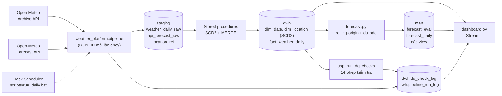

# Kiến trúc

## Luồng dữ liệu

## Ba tầng dữ liệu

| Tầng | Vai trò | Ghi chú |
|---|---|---|
| `staging` | Nơi API đổ vào. Phản hồi JSON được chuyển thành bảng có cấu trúc, chưa làm sạch hay biến đổi nghiệp vụ | Là landing/staging có cấu trúc, **không lưu payload JSON gốc**. Tên bảng có hậu tố `_raw` là để chỉ "chưa biến đổi" |
| `dwh` | Kho dữ liệu star schema: dimension và fact, cùng các bảng nhật ký vận hành | Nguồn duy nhất cho mọi phân tích và mô hình |
| `mart` | Kết quả mô hình và các view phục vụ dashboard | Có thể dựng lại từ `dwh` |

## Các bước của một lần chạy

1. **Danh sách địa điểm** đọc từ `staging.location_ref` (không hard-code trong Python).
2. **Nạp quan trắc** từ Archive API vào `staging.weather_daily_raw`: mỗi địa điểm một transaction, lỗi một nơi
   không làm hỏng các nơi khác. Trước khi nạp, dữ liệu qua lớp kiểm tra bằng Python.
3. **Lưu dự báo Open-Meteo** 1 đến 7 ngày tới vào `staging.api_forecast_raw` để đối chiếu với thực tế sau này.
4. **Nạp kho dữ liệu**: `usp_load_dim_location_scd2` trước, `usp_load_weather` sau.
5. **Kiểm tra chất lượng** bằng `usp_run_dq_checks`.
6. **Ước lượng mô hình dự báo**, kiểm thử ngược và ghi kết quả vào `mart`.
7. **Ghi nhật ký** lần chạy vào `dwh.pipeline_run_log`.

## Hai chế độ chạy

| Lệnh | Chế độ | Khi nào dùng |
|---|---|---|
| `python -m weather_platform.load_history` | `history`: xóa và nạp lại toàn bộ từ 01/01/2020 cho mọi địa điểm | Dựng hệ thống lần đầu hoặc nạp lại từ đầu |
| `python -m weather_platform.daily_update` | `incremental`: chỉ tải các ngày sau ngày cuối đã có | Chạy hằng ngày. Nếu staging còn rỗng, tự nạp toàn bộ lịch sử |

Hai chế độ dùng chung một hàm nạp (`ingestion.ingest_observations`), chỉ khác cách tính khoảng ngày.

## Truy vết dữ liệu (lineage)

Mỗi lần chạy có `RUN_ID` dạng `yyyymmdd_HHMMSS`. Mã này xuất hiện trong:

- mỗi dòng log (`logs/daily_update.log`),
- `staging.weather_daily_raw.pipeline_run_id` và `staging.api_forecast_raw.pipeline_run_id`,
- `mart.forecast_eval.run_id` và `mart.forecast_daily.run_id`,
- `dwh.dq_check_log.run_id`,
- `dwh.pipeline_run_log.run_id` (một dòng mỗi lần chạy).

Có thể trả lời: "dòng staging này do lần chạy nào nạp, lần chạy đó kết thúc thế nào, các phép kiểm tra lúc đó ra sao".
Bảng fact chưa lưu `run_id` (chỉ có `created_at`, `updated_at`); truy vết đến fact đi qua staging.

## Xử lý lỗi từng phần

Pipeline không dừng ở lỗi đầu tiên. Mỗi bước và mỗi địa điểm được cô lập, kết quả được ghi rõ,
ví dụ `Quan trắc: 4/5 địa điểm thành công, 12 dòng mới; lỗi: Đà Nẵng`.

| Trạng thái | Điều kiện | Mã thoát |
|---|---|---|
| `SUCCESS` | Không có lỗi nào | 0 |
| `PARTIAL` | Kho được cập nhật nhưng có địa điểm hoặc bước phụ lỗi, hoặc có phép kiểm tra FAIL | 1 |
| `FAILED` | Không kết nối được DB, bước nạp kho lỗi, hoặc không nạp được địa điểm nào | 2 |

Mã thoát khác 0 được Task Scheduler ghi nhận là lần chạy thất bại.
