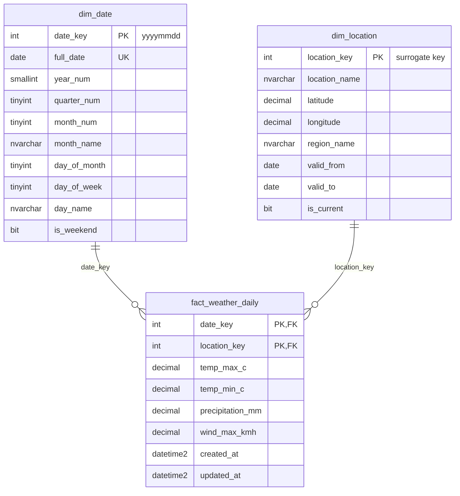
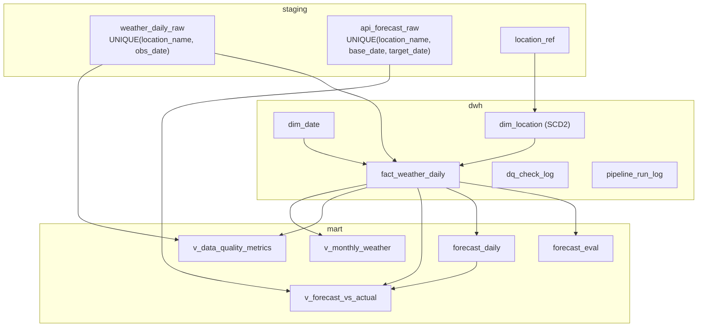

# Mô hình dữ liệu

## Star schema của kho dữ liệu

Grain của `fact_weather_daily`: **một dòng = một địa điểm trong một ngày**.

`dim_location` áp dụng **SCD Type 2**: khi tọa độ hoặc vùng của một địa điểm đổi, phiên bản cũ được đóng
(`valid_to` = ngày hiệu lực trừ 1, `is_current` = 0) và một phiên bản mới được mở. Mỗi dòng fact trỏ về phiên bản
địa điểm có hiệu lực tại ngày quan sát.

## Các bảng khác

## Vì sao thiết kế như vậy

| Câu hỏi | Trả lời |
|---|---|
| Vì sao có staging, dwh và mart? | Tách việc lấy dữ liệu khỏi việc xử lý: lỗi ở bước biến đổi thì chạy lại từ staging, không phải gọi lại API. Mart có thể dựng lại từ dwh |
| Grain của fact là gì? | Một địa điểm trong một ngày. Mọi phép tổng hợp đều đi từ grain này |
| Vì sao dùng surrogate key? | Tên địa điểm có thể đổi hoặc trùng; khóa số nhỏ, join nhanh, và cho phép lưu nhiều phiên bản lịch sử của cùng một địa điểm (SCD2) |
| Vì sao cần SCD2 cho địa điểm? | Tọa độ đại diện có thể được chỉnh lại. Dữ liệu cũ vẫn phải gắn đúng với tọa độ đã dùng lúc lấy dữ liệu |
| Nếu tọa độ Vũng Tàu đổi thì dữ liệu lịch sử ra sao? | Các dòng fact cũ giữ nguyên, vẫn trỏ về phiên bản cũ. Chỉ dữ liệu từ ngày hiệu lực trở đi trỏ về phiên bản mới. Xem `sql/05_demo/scd2_demo.sql` |
